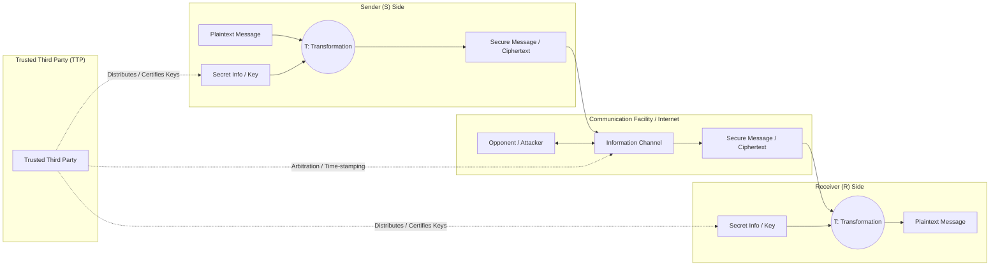
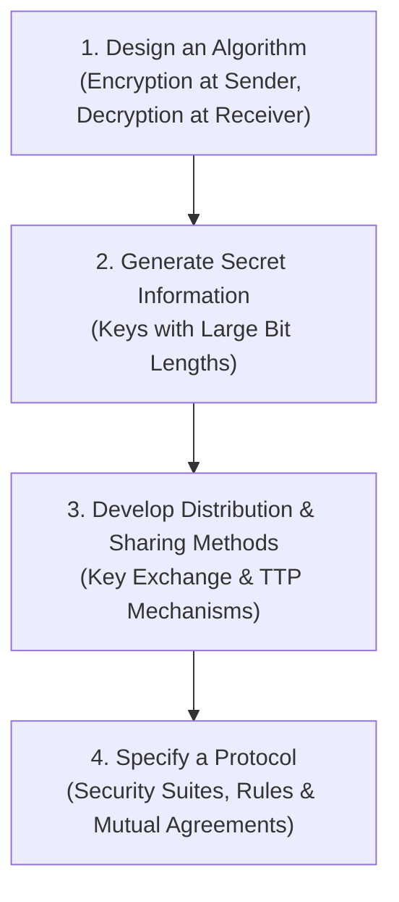
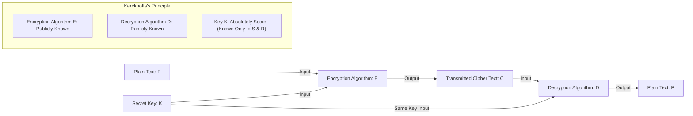
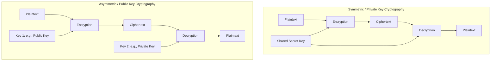
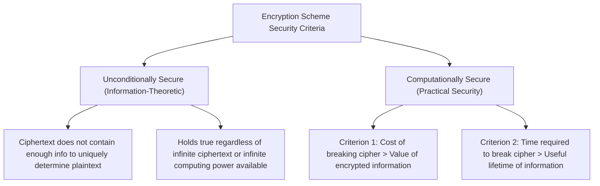

# Cryptography and Network Security Study Material

---

# Part 1: Network Security Model (Video 1)

## 1. Outline

- **[00:00]** Course and Lecture Introduction
- **[00:10]** Learning Outcomes
- **[00:29]** The Model for Network Security (Architecture & Workflow)
  - Sender ($S$), Receiver ($R$), and Message Transmission
  - Security-Related Transformation ($T$) and Key / Secret Information
  - Secure Message (Ciphertext) across the Information Channel
  - Opponents (Sniffers / Eavesdroppers) on the Channel
  - Role of the Trusted Third Party (TTP) and Real-World Examples
  - Cryptography vs. Steganography distinction
- **[06:08]** Four Major Tasks in Designing a Network Security Service
  - Task 1: Design an Algorithm
  - Task 2: Generate Secret Information
  - Task 3: Develop Methods for Distribution and Sharing of Information
  - Task 4: Specify a Protocol
- **[08:31]** Network Access Security Model
  - Threat Agents / Opponents (Human Hackers vs. Malicious Software)
  - Access Channel
  - Gatekeeper Function (Firewalls and Traffic Filtering)
  - Information System Assets (Computing Resources, Data, Processes, Software)
  - Internal Security Controls (Antivirus and Local Host Defenses)
  - Internal vs. External Threat Comparison
- **[11:18]** Review of Outcomes and Conclusion

---

## 2. Exhaustive Section Notes

### [00:10] Learning Outcomes

#### On-Screen Slide Text
```text
Outcomes
Upon the completion of this session, the learner will be able to
★ Understand the model for network security.
★ Know the four basic tasks in designing a particular security service.
★ Understand the network access security model.
```

---

### [00:29] Model for Network Security (Architecture & Workflow)

#### Visual Layout & Component Descriptions
- **Background**: Dark slate teal (`#061a1a`).
- **Heading**: "Model for Network Security" in yellow bold text at the top left.
- **Top Center Element**: A label `Trusted Third Party` in light green font.
  - An orange bidirectional/split angled arrow branches from the Trusted Third Party down to the sender's Secret Info arrow/node and down to the receiver's Secret Info arrow/node.
  - A straight orange double-ended vertical arrow connects the Trusted Third Party directly to the communication channel in the center.
- **Left Side (Sender)**:
  - Label `S` (Sender) in cyan/light blue above a document icon.
  - Document icon represents the plaintext `Message` (cyan text below it).
  - A horizontal arrow points right into an orange circle labeled `T` (Security-related transformation).
  - A vertical upward arrow in bright green comes from the label `Secret info` (in magenta text) and feeds into the circle `T`.
  - A horizontal arrow leaves circle `T` pointing to a document icon featuring a yellow padlock on top, labeled `Secure Message` (magenta text).
- **Center (Communication Channel)**:
  - A horizontal rounded cylindrical pipe/bar representing the transmission channel/Internet.
  - Below this channel is a double-headed vertical arrow pointing to `Opponent` (in green text).
- **Right Side (Receiver)**:
  - Document icon with a yellow padlock labeled `Secure Message` (magenta text) emerging from the channel.
  - Horizontal arrow pointing into an orange circle labeled `T` (Security-related transformation).
  - A vertical upward arrow in bright green comes from the label `Secret info` (magenta text) pointing into circle `T`.
  - Horizontal arrow leaves circle `T` pointing to a clean document icon labeled `Message` (cyan text) beneath it.
  - Label `R` (Receiver) in cyan text above the final document icon.
- **Bottom Legend Text**:
  ```text
  Legends used
  T - Security related transformation; S - Sender; R - Receiver
  ```

#### Flowchart / Architecture Diagram (Mermaid)



#### Detailed Concepts, Definitions, and Claims
1. **Core Problem**:
   - Two principals—Sender ($S$) and Receiver ($R$)—wish to exchange data/messages over an insecure communication network (such as the Internet).
   - In computer networking, the focus is routing and reliable delivery; in network security, the focus is preventing unauthorized disclosure, tampering, and intrusion.
2. **Transformation Function ($T$)**:
   - The sender produces an original intelligible message (the **plaintext**).
   - Instead of sending plaintext across the Internet, the sender passes the plaintext into a security-related transformation ($T$).
   - $T$ takes two inputs:
     1. The plaintext message.
     2. A piece of **Secret Information** (commonly a cryptographic **Key**).
   - $T$ produces an output called the **Secure Message** (or **ciphertext**).
   - At the receiver side, a complementary security-related transformation ($T$) takes the secure message and the corresponding secret information (key) as inputs and decrypts/re-transforms the ciphertext back into the original plaintext message.
3. **Why Label it '$T$' Instead of '$E$' for Encryption?**:
   - The instructor explicitly clarifies: Encryption is only *one* method of achieving a secure transformation.
   - The transformation $T$ can also represent other protective mechanisms, such as **Steganography** (the practice of hiding secret data within another innocuous carrier medium, such as an image, audio file, or carrier text).
   - Therefore, $T$ denotes general **Security-Related Transformation**.
4. **The Communication Channel**:
   - The secure message traverses a transmission path (public Internet, telephone lines, wireless links).
   - Along this path lies the **Opponent** (attacker/eavesdropper).
   - The opponent can sniff the line and intercept messages, but because the message is converted into ciphertext, the opponent cannot read or comprehend the underlying information.
5. **The Real Root of Security**:
   - Real security does *not* depend on the secrecy of the algorithm $T$. Algorithms are generally public and standardized.
   - The true security depends directly on:
     1. The strength/complexity of the algorithm.
     2. The secrecy and mathematical size (length in bits) of the **secret information (key)**.
     3. If the key space is small, an attacker can readily mount a brute-force attack and break the system.
6. **Trusted Third Party (TTP)**:
   - A TTP is an independent, trusted entity mediating between sender and receiver.
   - *Roles*: Distributing secret keys securely to both parties, providing digital certificates (e.g., SSL/TLS certificates), arbitrating disputes, and verifying identities.
   - *Examples*:
     - A user visiting `google.com` or an online banking portal. Because confidential financial/personal data is transferred, SSL certificates signed by a trusted Certificate Authority (CA, a TTP) validate the authenticity of the banking server and secure the session key exchange.

---

### [06:08] Four Major Tasks in Designing a Network Security Service

#### On-Screen Slide Text
```text
Model for Network Security

Four major tasks:
1. Design an algorithm.
2. Generate the secret information.
3. Develop methods for distribution and sharing of information.
4. Specify a protocol.
```

#### Detailed Breakdown of the Four Tasks



1. **Task 1: Design an Algorithm**
   - Must design a mathematically resilient transformation function that performs the security operation.
   - Includes designing the **encryption algorithm** on the sender side and the complementary **decryption algorithm** on the receiver side.
   - The algorithm must be sufficiently robust that an opponent intercepting the ciphertext cannot reverse-engineer or compute the plaintext without the key.

2. **Task 2: Generate the Secret Information**
   - Algorithms take two inputs: plaintext and secret information (key).
   - Security heavily hinges on generating high-entropy secret information with an adequately large number of bits (large key space) so that exhaustive search (brute-force attacks) is computationally infeasible.

3. **Task 3: Develop Methods for Distribution and Sharing of Information**
   - The communicating parties need access to the proper keys.
   - In symmetric cryptography, both $S$ and $R$ must share the exact same secret key without an adversary intercepting it during transit across the Internet.
   - Hence, secure distribution mechanisms (e.g., Key Distribution Centers, out-of-band channels, Diffie-Hellman key exchange, asymmetric key wrappers) are required.

4. **Task 4: Specify a Protocol**
   - A security protocol defines the strict rules, formats, message sequences, and conventions that both sender and receiver must adhere to when utilizing security algorithms and keys.
   - A protocol packages all required security mechanisms (authentication, integrity, encryption) into a cohesive security suite (e.g., SSL/TLS, IPsec).
   - Standardized protocols ensure interoperability and predictable, verified security behavior.

---

### [08:31] Network Access Security Model

#### Visual Layout & Component Descriptions
- **Slide Title**: "Network Access Security Model" in yellow text.
- **Left Side**:
  - Graphic of an aggressive red-faced horned devil icon, labeled `Opponent`.
  - Subtext below the icon:
    ```text
    Human (Attacker)
    Software (Virus, Worm)
    ```
- **Center**:
  - Horizontal metallic cylindrical conduit representing the `Access channel` (e.g., the Internet).
  - At the right end of the conduit stands a Queen's Guard soldier with a tall bearskin hat inside/behind a barred security gate, labeled `Gatekeeper function`.
- **Right Side**:
  - Label: `Information System` in cyan text.
  - A gray-bordered box enclosed with internal assets and defenses:
    ```text
    Computing Resources
    (Processor, Memory, I/O)
    Data
    Process
    Software
    Internal Security controls
    ```

#### Network Access Security Diagram (Mermaid)

```mermaid
graph LR
    subgraph Threat_Source ["Opponent / Attacker"]
        Opp["Opponent<br/>• Human Attacker (Hacker)<br/>• Malicious Software (Virus, Worm, Trojan)"]
    end

    subgraph Transmission ["Access Channel"]
        Chan["Access Channel (Internet / Network Link)"]
    end

    subgraph Defense_Boundary ["Perimeter Defense"]
        GK["Gatekeeper Function<br/>(Firewall, Access Control List, Traffic Filter)"]
    end

    subgraph Protected_System ["Information System"]
        direction TB
        CR["Computing Resources<br/>(Processor, Memory, I/O)"]
        D["Data (Databases, Files)"]
        P["Processes"]
        SW["Software / Applications"]
        ISC["Internal Security Controls<br/>(Antivirus, Host IDS, OS Permissions)"]
    end

    Opp --> Chan
    Chan --> GK
    GK -->|Permitted Traffic Only| Protected_System
```



#### Detailed Concepts, Definitions, and Claims
1. **The Opponent**:
   - Can be an external **human** (malicious hacker, cybercriminal, unauthorized penetrator).
   - Can be automated **malicious software** (viruses, worms, Trojan horses, automated bots, ransomware).
2. **Access Channel**:
   - The path over which an opponent seeks unauthorized entry, typically the Internet or external network links.
3. **The Information System**:
   - The target system requiring strict protection.
   - Contains vital assets:
     - **Computing Resources**: Processors (CPU), memory (RAM), input/output (I/O) facilities.
     - **Data**: Files, sensitive records, proprietary records, databases.
     - **Processes**: Running system and application operations.
     - **Software**: Operating systems and installed software packages.
4. **Gatekeeper Function**:
   - Acts as the primary perimeter defense line (analogous to a security guard standing at a gate).
   - In computer networking, this is implemented via **Firewalls**, intrusion prevention systems (IPS), packet filters, or login/authentication gateways.
   - *Role*: Analyzes all incoming and outgoing traffic, inspects packet contents and headers, and determines whether traffic is permitted or blocked.
   - It must distinguish between legitimate users and malicious intrusions or automated malware payloads.
5. **Internal Security Controls**:
   - Mechanisms deployed directly on host machines within the information system (defense-in-depth).
   - *Example*: Host-based **antivirus programs**, file integrity checkers, access control lists, operating system permissions.
   - Protects against threats that manage to bypass the gatekeeper, or threats executing from within the network.
6. **Internal vs. External Threats**:
   - An employee or internal user performing unauthorized or malicious activities is an **internal attacker**.
   - While internal attacks can cause severe harm, the external threat surface (opponents traversing the Internet attempting to trick or bypass the gatekeeper) represents the pervasive vector addressed by the network access security model.

---

# Part 2: Cryptography & Symmetric Cipher Model (Video 2)

## 1. Outline

- **[00:00]** Course and Lecture Introduction
- **[00:10]** Learning Outcomes
- **[00:36]** The General Cryptographic Process & The Symmetric Cipher Model
  - Plaintext and Ciphertext Concepts
  - Mathematical Inputs to Encryption ($P$, $K$) and Decryption ($C$, $K$)
  - The Kerckhoffs Principle Rationale (Public Algorithms vs. Secret Keys)
  - Definition and Working of the Symmetric Cipher Model
  - Hypothetical Example (Key = 100) vs. Cryptographic Reality
- **[04:10]** Formal Definition of Cryptography
  - Breakdown: Intelligible vs. Unintelligible Transformation
  - Retransformation back to Original Form
- **[05:56]** Classification / Types of Cryptography
  - Symmetric Cryptography (Private Key Cryptography)
  - Asymmetric Cryptography (Public Key Cryptography)
  - The Two-Key Mathematical Relationship (Public Key vs. Private Key)
- **[10:07]** Security Criteria of Encryption Schemes
  - Unconditionally Secure Encryption Schemes (Shannon's Perfect Secrecy Principle)
  - Computationally Secure Encryption Schemes (Cost vs. Value, Time vs. Lifetime)
- **[13:03]** Review of Outcomes and Conclusion

---

## 2. Exhaustive Section Notes

### [00:10] Learning Outcomes

#### On-Screen Slide Text
```text
Outcomes
Upon the completion of this session, the learner will be able to
★ Understand the symmetric cipher model.
★ Understand the basics and types of cryptography.
★ Know the importance of encryption and decryption.
★ Understand unconditionally secure and computationally secure encryption schemes.
```

---

### [00:36] General Cryptographic Flow & Symmetric Cipher Model

#### Visual Layout & Component Descriptions
- **Slide Title**: "Cryptography" (initially) / "Symmetric Cryptography" (later at 06:16).
- **Background**: Dark slate teal (`#061a1a`).
- **Left to Right Elements**:
  1. `Plain Text`: Icon of a document page with a pencil writing on it.
  2. A red pixelated arrow points to:
  3. `Encryption Algorithm`: Icon of two green interlocking gears/cogs.
  4. Vertically above the green gears: A yellow classic metallic key graphic pointing downwards into the encryption algorithm.
  5. An orange horizontal arrow leaving the gears labeled: `Transmitted Cipher Text`.
  6. The orange arrow points into:
  7. `Decryption Algorithm`: Icon of two reddish-pink interlocking gears/cogs.
  8. Vertically above the reddish-pink gears: An identical yellow key graphic pointing downwards into the decryption algorithm.
  9. A red pixelated horizontal arrow leaves the decryption algorithm pointing to:
  10. `Plain Text`: Identical document page with pencil icon.
- **At 06:32**: A curved double-headed yellow arrow spans between the two yellow keys, labeled: `Same Key`.

#### Mathematical Formulation & Notation
- Let $P$ (or $M$) be the original **Plaintext Message**.
- Let $C$ be the **Ciphertext** (Transmitted Cipher Text).
- Let $K$ be the **Secret Key**.
- Let $E$ be the **Encryption Algorithm**.
- Let $D$ be the **Decryption Algorithm**.

The encryption process is:
$$C = E(K, P)$$

The decryption process is:
$$P = D(K, C) = D(K, E(K, P))$$

Both algorithms take exactly two inputs:
- $E$ takes $(P, K)$ and produces $C$.
- $D$ takes $(C, K)$ and recovers $P$.

#### Diagram of Symmetric Cipher Model (Mermaid)



#### Detailed Concepts, Claims, and Spoken Explanations
1. **Inputs to Algorithms**:
   - The speaker points out that at first glance, people often think encryption only takes one input (the plaintext). In reality, it strictly requires two: the **plaintext** and the **key**.
   - Decryption similarly requires two inputs: the **ciphertext** and the **key**.
2. **Public Algorithms vs. Secret Keys**:
   - In modern cryptography, the encryption and decryption algorithms ($E$ and $D$) are made **publicly known**.
   - Even adversaries know exactly what mathematical algorithm was used to scramble the plaintext.
   - Real security rests solely in maintaining the absolute secrecy of the **key**.
3. **Catastrophic Impact of Key Compromise**:
   - If an attacker guesses one plaintext snippet from a ciphertext, that is an isolated break.
   - But if an attacker uncovers the **key**, they can read *all past, present, and future communications* exchanged between that sender and receiver.
4. **Symmetric Cipher Model Definition**:
   - A model where the sender and receiver use the exact **same key** for both encryption and decryption.
   - Requires mutual agreement between sender and receiver to never disclose the key.
5. **Concrete Example / Numbers Explained by the Speaker**:
   - *Hypothetical toy example*: Suppose the key value is $K = 100$.
     - The sender encrypts the plaintext using $K = 100$.
     - The receiver decrypts the ciphertext using $K = 100$.
   - *Speaker Emphasis & Real-World Reality*:
     - The number $100$ is trivial and easily crackable in microseconds by an attacker.
     - Practical, industrial cryptographic systems use extremely large numbers (e.g., 128-bit, 256-bit, 2048-bit numbers) containing long sequences of bits that are completely unreadable and unguessable by humans, rendering brute-force attacks infeasible.

---

### [04:10] Formal Definition of Cryptography

#### On-Screen Text
```text
Cryptography
"The art or science encompassing the principles and methods of 
transforming an intelligible message into one that is unintelligible, 
and then retransforming that message back to its original form."
```

#### Detailed Breakdown of the Formal Definition
- **Art or Science**: Encompasses mathematical rigor (science) combined with creative algorithm and protocol design (art).
- **Intelligible Message**: The original, human-readable or computer-readable message, formally designated as **Plaintext**.
- **Unintelligible Message**: The scrambled, garbled, unrecognizable ciphertext produced by the transformation. To any unauthorized eavesdropper, it carries no apparent meaning.
- **Retransforming back to Original Form**: Executed at the receiver side via decryption, which takes the unintelligible message and reconstructs the authentic original plaintext.

---

### [05:56] Types of Cryptography

#### On-Screen Slide Text (Summary of Branches)
```text
Types of Cryptography
★ Symmetric Cryptography (Private Key Cryptography)
★ Asymmetric Cryptography (Public Key Cryptography)
```

#### Detailed Comparison: Symmetric vs. Asymmetric

| Feature | Symmetric Cryptography | Asymmetric Cryptography |
| :--- | :--- | :--- |
| **Alternative Name** | Private Key Cryptography / Secret Key Cryptography / Conventional Cryptography | Public Key Cryptography |
| **Number of Keys** | Single shared key ($K$) | Key pair ($K_{pub}, K_{priv}$) |
| **Key Usage** | $K$ is used for *both* encryption and decryption | One key is used for encryption; a *different, mathematically related key* is used for decryption |
| **Key Secrecy** | Kept strictly private between sender and receiver; zero public disclosure | Public key is published openly to the world; Private key is kept strictly secret by the owner |
| **Slide Visuals** | Identical yellow keys above both encryption and decryption gears; curved arrow labeled `Same Key` | Yellow key at encryption gear; Blue key at decryption gear; curved arrow labeled `Different Keys` |



#### Worked Example and Mathematical Reasoning in the Lecture
- **Speaker's Question**: "Is asymmetric cryptography practically possible? Can you encrypt with key $100$ and decrypt with a completely different key like $500$?"
- **Explanation**:
  - Yes, it is fully viable provided the keys satisfy specific **underlying mathematical relationships** (e.g., modular arithmetic, prime factorization, or discrete logarithms).
  - One key is designated as the **Public Key** ($K_{pub}$) and can be freely published.
  - The second key is designated as the **Private Key** ($K_{priv}$) and is known only to the individual recipient.
  - The mathematical trapdoor ensures that computing the private key from the public key is computationally infeasible.

---

### [10:07] Encryption Schemes Security Criteria

#### On-Screen Slide Text
```text
Encryption schemes
★ Unconditionally secure
★ Computationally secure
```

#### Detailed Concepts, Definitions, and Criteria



#### 1. Unconditionally Secure
- **Formal Definition (Verbatim)**:
  > "An encryption scheme is said to be unconditionally secure if the ciphertext that is generated by this encryption algorithm or encryption scheme does not contain enough information to determine uniquely the corresponding plaintext, no matter how much ciphertext is available."
- **Properties & Implications**:
  - This is an **information-theoretic security** guarantee (often associated with Claude Shannon's One-Time Pad).
  - No matter how much computational power, time, or ciphertext an attacker possesses (even infinite computing power), it is mathematically impossible to decrypt the message, because all candidate plaintexts remain equally probable.
  - If an attacker intercepts massive volumes of ciphertext and is able to uniquely determine or deduce the plaintext, the scheme is *not* unconditionally secure.

#### 2. Computationally Secure
- **Formal Definition (Verbatim)**:
  > "The encryption algorithm or encryption scheme is said to be computationally secure, if:
  > 1. The cost of breaking the cipher exceeds the value of the encrypted information.
  > 2. The time required for the attacker to break the ciphertext exceeds the useful lifetime of the information."
- **Criterion 1: Economic Cost vs. Value**:
  $$\text{Cost to Break} > \text{Value of Data}$$
  - If decrypting an intercepted bank transfer instruction containing $\$1,000$ requires renting a supercomputing cluster costing $\$1,000,000$, the cipher is computationally secure. Breaking it yields a massive net loss.
- **Criterion 2: Time Required vs. Useful Lifetime**:
  $$\text{Time to Break} > \text{Useful Lifetime of Data}$$
  - If tactical military intelligence or a temporary financial quote has a useful lifetime of $10$ minutes, but decrypting the intercepted ciphertext via brute-force requires $50$ years, the cipher is computationally secure. By the time the attacker derives the plaintext, the information is obsolete and worthless.
- **Engineering Principle**:
  - Almost all practical modern ciphers (e.g., AES, RSA) are **computationally secure** rather than unconditionally secure, because unconditional security requires key lengths equal to message lengths (One-Time Pad), which is difficult to manage at scale.

---

## 3. Ambiguities, Skipped Elements, and Flags

1. **[UNCLEAR @04:28 in Video 1]**:
   - The instructor introduces the Trusted Third Party (TTP) and draws arrows from the TTP to the sender, receiver, and the channel, mentioning SSL certificates and Certificate Authorities. However, the exact mathematical role of the TTP in key exchange (e.g., Kerberos KDC, Diffie-Hellman arbitration, or Public Key Infrastructure / X.509 certificates) is deferred with the comment: *"We will see about the role of trusted third party in the last chapter of this subject, for time being, just understand a trusted third party is involved."*
2. **[UNCLEAR @05:40 in Video 1]**:
   - The instructor notes that transformation $T$ can be Steganography, but does not provide an architectural model or formula for steganographic embedding (cover object + secret message $\rightarrow$ stego object). This topic is deferred: *"Where in steganography we are going to hide the data in some other form. We are going to talk about that in the upcoming lecture anyway."*
3. **[UNCLEAR @09:12 in Video 2]**:
   - When discussing asymmetric key pairs, the instructor mentions keys like $100$ and $500$ as hypothetical integers, and mentions that one is public and the other is private, but explicitly declines to assign which is which: *"So here, I didn't mention which key is a public key and which key is a private key. Anyway, we will be understanding this in the upcoming lecture what is a public key and what is a private key."*

---

## 4. Comprehensive Glossary of Terms

- **Access Channel**: The physical or logical transmission medium (e.g., the Internet, wireless connection) through which an external entity attempts to reach an information system.
- **Asymmetric Cryptography (Public Key Cryptography)**: A cryptographic paradigm that uses an asymmetric pair of mathematically related keys: a public key (used for encryption or signature verification) and a private key (used for decryption or signature generation).
- **Ciphertext (Secure Message)**: The scrambled, unintelligible output of an encryption algorithm operating on a plaintext message using a cryptographic key.
- **Computationally Secure**: An encryption scheme where the computational effort required to break the cipher exceeds the economic value of the underlying data, and/or the time needed to break it exceeds the data's operational lifetime.
- **Cryptography**: The art or science encompassing the principles and methods of transforming an intelligible message into one that is unintelligible, and retransforming that message back to its original form.
- **Decryption Algorithm ($D$)**: The mathematical procedure that transforms ciphertext back into plaintext using the appropriate key.
- **Encryption Algorithm ($E$)**: The mathematical procedure that transforms plaintext into ciphertext using a key.
- **Gatekeeper Function**: A boundary control mechanism (such as a firewall, packet filter, or login screen) positioned between an access channel and an information system to filter traffic and prevent unauthorized intrusion.
- **Information System**: An organization's computing infrastructure containing computing resources (processor, memory, I/O), data, running processes, software, and local internal defenses.
- **Internal Security Controls**: Local host-based defenses within an information system (e.g., antivirus programs, file integrity monitors, operating system access rights) designed to detect and block malicious actions that bypass perimeter defenses.
- **Kerckhoffs's Principle**: The foundational cryptographic design principle stating that a cryptographic system must remain secure even if everything about the system (including the algorithm) is public knowledge, provided only the key is kept secret.
- **Key (Secret Information)**: An input (a sequence of bits/numbers) passed into cryptographic algorithms to control the encryption and decryption transformations.
- **Network Security Model**: An architectural abstraction showing how two principals securely transfer data across an untrusted network in the presence of adversaries, employing security transformations, keys, and potentially a trusted third party.
- **Opponent (Attacker)**: Any entity (human cybercriminal, unauthorized sniffer, or automated malicious software such as a virus or worm) attempting to compromise the confidentiality, integrity, or availability of communications or information systems.
- **Plaintext (Message)**: The original, unaltered, intelligible message or data prior to entering an encryption algorithm.
- **Security-Related Transformation ($T$)**: An algorithm-driven operation (such as encryption or steganographic encoding) applied to plaintext using secret information to protect message confidentiality and integrity.
- **Steganography**: The technique of hiding a secret message inside an innocuous carrier medium (such as an image or audio file) so that the very existence of the communication is concealed.
- **Symmetric Cryptography (Private Key Cryptography)**: A cryptographic scheme in which the sender and receiver share and use the exact same secret key for both encryption and decryption.
- **Trusted Third Party (TTP)**: An independent, authoritative entity trusted by communicating principals to manage identity verification, issue digital certificates, and facilitate secure key distribution.
- **Unconditionally Secure**: An encryption scheme whose ciphertext does not contain sufficient statistical information to determine the plaintext uniquely, regardless of how much ciphertext is intercepted or how much computing power is applied.