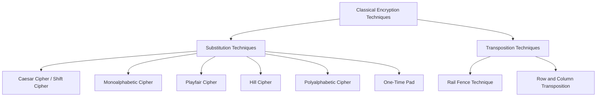
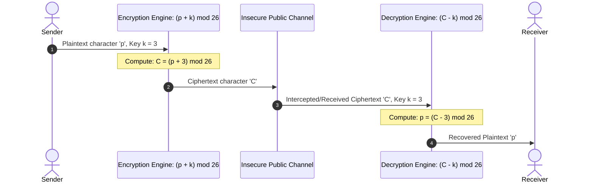

# Comprehensive Study Guide: Classical Encryption Techniques, Caesar Cipher, and Shift Ciphers

---

## 1. Master Outline

| Video | Topic / Section | Start Timestamp |
| :--- | :--- | :--- |
| **Video 1** | **Classical Encryption Techniques** | `[00:00]` |
| Video 1 | Course Introduction & Title Slide | `[00:00]` |
| Video 1 | Session Learning Outcomes | `[00:11]` |
| Video 1 | Necessity of Encryption & Classical Context | `[00:27]` |
| Video 1 | The Substitution Technique: Definition & Mapping | `[01:58]` |
| Video 1 | Worked Example: Substitution on Plaintext `"bag"` | `[03:10]` |
| Video 1 | The Transposition Technique: Definition & Permutations | `[04:53]` |
| Video 1 | Worked Example: Transposition on Plaintext `"NESO"` | `[05:16]` |
| Video 1 | Comparison: Substitution vs. Transposition Techniques | `[06:33]` |
| Video 1 | Taxonomy of Classical Encryption Ciphers | `[07:29]` |
| Video 1 | Video Summary & Wrap-Up | `[08:08]` |
| **Video 2** | **Caesar Cipher (Part 1)** | `[00:00]` |
| Video 2 | Title & Session Outcomes | `[00:00]` |
| Video 2 | Classical Cryptosystem Classification Context | `[00:20]` |
| Video 2 | Caesar Cipher: Definition, History, and Core Rule | `[00:43]` |
| Video 2 | English Alphabet Index Mapping Table ($0$ to $25$) | `[01:57]` |
| Video 2 | Mathematical Formulation: Encryption & Decryption | `[03:07]` |
| Video 2 | Worked Example Setup: Encrypting `"neso academy"` | `[06:07]` |
| Video 2 | Detailed Step-by-Step Encryption Calculations | `[07:18]` |
| Video 2 | Direct Shift vs. Mathematical Equation Approach | `[10:00]` |
| Video 2 | Wrap-Around and Modular Arithmetic Calculation for `'y'` | `[10:30]` |
| Video 2 | Final Ciphertext Assembly | `[12:10]` |
| Video 2 | Homework Problem: Decryption of `"QHWZRUN VHFXULWB"` | `[12:28]` |
| **Video 3** | **Caesar Cipher (Part 2) & Brute Force Attack** | `[00:00]` |
| Video 3 | Title & Session Learning Outcomes | `[00:00]` |
| Video 3 | Review of Caesar Cipher as a Special Shift Cipher | `[01:08]` |
| Video 3 | Shift Cipher Definition & Valid Key Domain | `[01:29]` |
| Video 3 | Worked Example: Shift Cipher on Plaintext `"Neso"` ($K = 4$) | `[02:26]` |
| Video 3 | Implementation Considerations: Custom Mapping vs. ASCII | `[04:36]` |
| Video 3 | Pros and Cons of Caesar Cipher | `[05:07]` |
| Video 3 | Brute-Force Attack Concept and Key Space Analysis | `[06:27]` |
| Video 3 | Full Brute-Force Cryptanalysis Table for `"SQDYMZK"` | `[07:05]` |
| Video 3 | Plaintext Recovery (`"GERMANY"`), Key Extraction & Cryptanalysis Definition | `[08:05]` |
| Video 3 | Homework Problems: Shift Cipher Practice | `[09:03]` |
| Video 3 | Video Summary & Wrap-Up | `[09:20]` |

---

## 2. Exhaustive Section-by-Section Study Material

---

### Video 1: Classical Encryption Techniques

#### [00:00] Course Introduction & Title Slide
- **Slide Text Transcribed Exactly:**
```text
Cryptography and Network Security
Classical Encryption Techniques
NESO ACADEMY
```
- **Spoken Details & Context:** The instructor welcomes viewers and establishes this lecture as the foundational introduction to classical cryptography within the Cryptography and Network Security course.

---

#### [00:11] Session Learning Outcomes
- **Slide Text Transcribed Exactly:**
```text
Outcomes
Upon the completion of this session, the learner will be able to
★ Know the classical encryption techniques.
★ Understand the difference between substitution and transposition techniques.
```
- **Spoken Details:** The two main objectives are formally stating the classical cryptographic systems and establishing the theoretical and mechanical distinctions between substitution-based and transposition-based algorithms.

---

#### [00:27] Necessity of Encryption & Classical Context
- **Concepts & Explanations:**
  - Plaintext data cannot be transmitted over public communication channels (like the Internet) in its raw, readable form.
  - Doing so leaves communication exposed to adversaries who can initiate attacks. Attacks are broadly categorized into:
    1. **Active Attacks:** Where the attacker alters data, injects unauthorized messages, or disrupts normal service.
    2. **Passive Attacks:** Where the attacker intercepts and eavesdrops on data without altering system resources.
  - If plaintext is sent unprotected, users become victims of information theft. Encryption transforms plaintext into ciphertext to prevent unauthorized extraction of intelligence.
  - Modern cryptosystems secure today's communications, but historically, security relied on **classical encryption techniques**.
  - **Status of Classical Encryption:** Classical techniques are now entirely **obsolete**. They are trivially broken, keys can be recovered quickly, and they provide virtually no defense against modern computational attacks. However, studying them is essential because they form the foundational design principles upon which modern encryption algorithms are built.

---

#### [01:58] The Substitution Technique: Definition & Mapping
- **Slide Text Transcribed Exactly:**
```text
Substitution Technique
★ Letters are replaced by other letters or symbols.
Example:
| a | b | c | d | e | f | g | h | i | j | k | l | m |
| n | o | p | q | r | s | t | u | v | w | x | y | z |
a -> M
b -> X
x -> Z
g -> A
Plaintext : bag
Ciphertext : XMA
```
- **Concept & Step of Reasoning:**
  - In a **substitution technique**, the sequential order of character positions is preserved, but the characters themselves are replaced by other letters, numbers, or symbols.
  - A substitution cipher sets up a mapping function:
    $$\pi : \Sigma \to \Sigma'$$
    where $\Sigma$ is the alphabet set of the plaintext and $\Sigma'$ is the ciphertext alphabet set.
  - In generic substitution, mappings can be arbitrarily defined or governed by an algebraic shift rule.

---

#### [03:10] Worked Example: Substitution on Plaintext `"bag"`
- **Slide Layout & Visual Representation:**
  - A two-row table displays lowercase English letters from `a` to `m` in row 1, and `n` to `z` in row 2.
  - Left column specifies the substitution key mapping:
    - $\text{a} \mapsto \text{M}$
    - $\text{b} \mapsto \text{X}$
    - $\text{x} \mapsto \text{Z}$
    - $\text{g} \mapsto \text{A}$
  - Below this mapping, text is rendered in green and pink:
    - `Plaintext : bag`
    - `Ciphertext : XMA`
- **Step-by-Step Encryption:**
  1. Plaintext input: `"bag"`.
  2. Character 1 (`'b'`): Consult mapping $\text{b} \mapsto \text{X}$. Result: `'X'`.
  3. Character 2 (`'a'`): Consult mapping $\text{a} \mapsto \text{M}$. Result: `'M'`.
  4. Character 3 (`'g'`): Consult mapping $\text{g} \mapsto \text{A}$. Result: `'A'`.
  5. Assembled Ciphertext: `"XMA"`.
- **Key Spoken Point & Key Management:**
  - This mapping table acts as the secret **key information**.
  - The key must be shared privately between the sender and receiver. If both parties use the exact same key mapping to perform encryption and decryption, this is symmetric encryption.

---

#### [04:53] The Transposition Technique: Definition & Permutations
- **Slide Text Transcribed Exactly:**
```text
Transposition Technique
★ Applying some sort of permutation on the plaintext letters.
★ Plaintext: NESO
★ Ciphertext: ESON, SONE, ONES, ENOS . . . .
```
- **Concept & Step of Reasoning:**
  - Unlike substitution, transposition **does not** replace letters with other letters or symbols.
  - Instead, it rearranges the positions of the existing characters according to a designated **permutation**.
  - The letter inventory and character frequencies of the message remain identical before and after encryption; only their linear ordering changes.

---

#### [05:16] Worked Example: Transposition on Plaintext `"NESO"`
- **Plaintext:** `"NESO"` (Length $L = 4$).
- **Permutation Examples Explained:**
  - Let index positions in plaintext be $1, 2, 3, 4$ for $\text{N}_1 \text{E}_2 \text{S}_3 \text{O}_4$.
  - **Permutation 1:** Resulting in `"ESON"`:
    - Plaintext letter 2 (`'E'`) moves to ciphertext position 1.
    - Plaintext letter 3 (`'S'`) moves to ciphertext position 2.
    - Plaintext letter 4 (`'O'`) moves to ciphertext position 3.
    - Plaintext letter 1 (`'N'`) moves to ciphertext position 4.
    - Index mapping: $(1, 2, 3, 4) \to (2, 3, 4, 1)$.
  - **Permutation 2:** Resulting in `"SONE"`:
    - Plaintext letter 3 (`'S'`) moves to position 1.
    - Plaintext letter 4 (`'O'`) moves to position 2.
    - Plaintext letter 1 (`'N'`) moves to position 3.
    - Plaintext letter 2 (`'E'`) moves to position 4.
    - Index mapping: $(1, 2, 3, 4) \to (3, 4, 1, 2)$.
  - **Alternative Permutations listed on slide:** `"ONES"`, `"ENOS"`, and many more (for $n = 4$, there are $4! = 24$ total possible permutations).

---

#### [06:33] Comparison: Substitution vs. Transposition Techniques
- **Direct Comparison Breakdown:**

| Dimension | Substitution Technique | Transposition Technique |
| :--- | :--- | :--- |
| **Character Identity** | Letters are replaced by new letters, numbers, or symbols. | Characters in ciphertext are identical to characters in plaintext; no new letters appear. |
| **Character Positioning** | Character positions remain unchanged. | Linear positions/order of characters are permuted. |
| **Character Frequencies** | Frequency distribution shifts to different symbols. | Frequency distribution of letters remains completely identical. |
| **Length Vulnerability** | Security relies on key space and language characteristics. | If plaintext length is short, the total number of permutations ($n!$) is very small and easily guessed. It is only effective for large message sizes. |

- **Diagram: Classical Cryptography Taxonomy:**



---

#### [07:29] Taxonomy of Classical Encryption Ciphers
- **Slide Text Transcribed Exactly:**
```text
Classical Encryption Technique
+--------------------------+----------------------------+
| Substitution             | Transposition              |
+--------------------------+----------------------------+
| ❖ Caesar Cipher          | ❖ Rail Fence               |
| ❖ Monoalphabetic Cipher  | ❖ Row Column Transposition |
| ❖ Playfair Cipher        |                            |
| ❖ Hill Cipher            |                            |
| ❖ Polyalphabetic Cipher  |                            |
| ❖ One-Time Pad           |                            |
+--------------------------+----------------------------+
```
- **Spoken Overview:** The instructor lists every cipher to be studied in subsequent lectures, grouping them into their exact mathematical families:
  - Substitution algorithms: Caesar cipher, monoalphabetic cipher, Playfair cipher, Hill cipher, polyalphabetic cipher, and One-Time Pad (OTP).
  - Transposition algorithms: Rail fence technique and row-column transposition technique.

---

#### [08:08] Summary and Next Steps
- Re-states learning outcomes: classical encryption techniques introduced; substitution vs. transposition contrasted.
- Points toward the next lecture: Part 1 of the Caesar Cipher.

---

### Video 2: Caesar Cipher (Part 1)

#### [00:00] Title & Session Outcomes
- **Slide Text Transcribed Exactly:**
```text
Outcomes
Upon the completion of this session, the learner will be able to
★ Understand Caesar cipher with examples.
```
- **Context:** The instructor specifies that this presentation is dedicated solely to Caesar cipher mechanics, mathematical formulation, and worked numerical examples.

---

#### [00:20] Classical Cryptosystem Classification Context
- Reconfirms the taxonomy established in Video 1: classical encryption is split into substitution and transposition. The Caesar cipher is the fundamental baseline under substitution.

---

#### [00:43] Caesar Cipher: Definition, History, and Core Rule
- **Slide Text Transcribed Exactly:**
```text
Caesar Cipher
★ Letters are replaced by other letters or symbols.
★ The earlier known and simplest method used be Julius Caesar.
★ Replacing each letter of the alphabet with the letter standing three places further down the alphabet.
Example:
```
*(Note: Slide text contains an exact grammatical error: `"used be Julius Caesar"` instead of `"used by Julius Caesar"`).*
- **Theoretical Explanation:**
  - Attributed to Julius Caesar for military correspondence.
  - Core mechanical rule: Each letter of the plaintext message is shifted exactly three positions forward (downward) in the alphabet.
  - When an shift reaches past the end of the alphabet (`Z`), it wraps circularly back to the beginning (`A`).

---

#### [01:57] English Alphabet Index Mapping Table ($0$ to $25$)
- **Slide Text / Graphic Transcribed Exactly:**
```text
|  0 |  1 |  2 |  3 |  4 |  5 |  6 |  7 |  8 |  9 | 10 | 11 | 12 |
|  A |  B |  C |  D |  E |  F |  G |  H |  I |  J |  K |  L |  M |

| 13 | 14 | 15 | 16 | 17 | 18 | 19 | 20 | 21 | 22 | 23 | 24 | 25 |
|  N |  O |  P |  Q |  R |  S |  T |  U |  V |  W |  X |  Y |  Z |
```
- **Critical Structural Details:**
  - Total letters: $N = 26$.
  - Numbering begins at $0$ (`A = 0`) and concludes at $25$ (`Z = 25`).
  - The instructor emphasizes: zero-indexing is necessary because modular arithmetic modulo 26 yields a complete residue system:
    $$\mathbb{Z}_{26} = \{0, 1, 2, \dots, 25\}$$
  - Starting indices at 1 would cause $26 \pmod{26} = 0$, breaking simple index mapping.

---

#### [03:07] Mathematical Formulation: Encryption & Decryption
- **Slide Text Transcribed Exactly:**
```text
Caesar Cipher
Algorithm:
For each plaintext letter ‘p’, substitute the ciphertext letter ‘C’:
C = E (p, k) mod 26 = (p + k) mod 26
p = D (C, k) mod 26 = (C - k) mod 26
```
- **Mathematical Formalization & Variable Definitions:**
  - $p$: Numerical value of the plaintext letter, where $p \in \{0, 1, \dots, 25\}$.
  - $C$: Numerical value of the ciphertext letter, where $C \in \{0, 1, \dots, 25\}$.
  - $k$: Secret shift key. For the traditional Caesar Cipher, $k \equiv 3$.
  - $E$: Encryption function taking inputs $p$ and $k$.
  - $D$: Decryption function taking inputs $C$ and $k$.
  - $\pmod{26}$: Modulo arithmetic operator ensuring numbers stay within the circular alphabet range $[0, 25]$.

- **LaTeX Formulas:**
  - **Encryption:**
    $$C = E(p, k) = (p + k) \pmod{26}$$
    $$\text{For Caesar Cipher specifically: } C = (p + 3) \pmod{26}$$
  - **Decryption:**
    $$p = D(C, k) = (C - k) \pmod{26}$$
    $$\text{For Caesar Cipher specifically: } p = (C - 3) \pmod{26}$$

- **Typographic Convention Established:**
  - Plaintext letters are written in lowercase: $p$ (`a, b, c, ...`).
  - Ciphertext letters are written in uppercase: $C$ (`A, B, C, ...`).
  - Spoken emphasis: This is not mathematically mandatory, but standard cryptographic elegance for unambiguous distinction.

- **System Sequence Diagram: Encryption & Decryption Mechanics:**


---

#### [06:07] Worked Example Setup: Encrypting `"neso academy"`
- **Slide Text Transcribed Exactly:**
```text
Caesar Cipher - Example
Question: Encrypt “neso academy” using Caesar cipher.
Solution:
```
- **Two-Row Solution Grid:**
  - Row 1: Plaintext letters (individual cells for each letter of `neso academy`).
  - Row 2: Derived ciphertext letters directly underneath.

| Row | 1 | 2 | 3 | 4 | 5 | 6 | 7 | 8 | 9 | 10 | 11 |
| :--- | :---: | :---: | :---: | :---: | :---: | :---: | :---: | :---: | :---: | :---: | :---: |
| **Plaintext ($p$)** | n | e | s | o | a | c | a | d | e | m | y |
| **Ciphertext ($C$)** | Q | H | V | R | D | F | D | G | H | P | B |

---

#### [07:18] Detailed Step-by-Step Encryption Calculations

1. **Letter `'n'`:**
   - Numerical index: $p = 13$
   - Formula: $C = (p + k) \pmod{26} = (13 + 3) \pmod{26} = 16 \pmod{26}$
   - Mathematical Division:
     $$\text{Dividend } = 16, \quad \text{Divisor } = 26$$
     $$16 = 26 \times 0 + 16 \implies \text{Remainder } = 16$$
   - Character at index $16$ is `'Q'`.
   - Result: $\text{'n'} \mapsto \text{'Q'}$.

2. **Letter `'e'`:**
   - Numerical index: $p = 4$
   - Formula: $C = (4 + 3) \pmod{26} = 7 \pmod{26} = 7$
   - Character at index $7$ is `'H'`.
   - Result: $\text{'e'} \mapsto \text{'H'}$.

3. **Letter `'s'`:**
   - Numerical index: $p = 18$
   - Formula: $C = (18 + 3) \pmod{26} = 21 \pmod{26} = 21$
   - Character at index $21$ is `'V'`.
   - Result: $\text{'s'} \mapsto \text{'V'}$.

---

#### [10:00] Direct Shift vs. Mathematical Equation Approach
- The instructor explains that learners can bypass writing the modulo equation for internal alphabet letters by counting 3 positions down:
  - For `'s'`: shift 1 $\to$ `'t'`, shift 2 $\to$ `'u'`, shift 3 $\to$ `'v'` $\implies$ `'V'`.
  - For `'o'`: index $14 + 3 = 17$ (or `'p'` $\to$ `'q'` $\to$ `'r'`) $\implies$ `'R'`.
  - For `'a'`: index $0 + 3 = 3$ $\implies$ `'D'`.
  - For `'c'`: index $2 + 3 = 5$ $\implies$ `'F'`.
  - For `'a'`: index $0 + 3 = 3$ $\implies$ `'D'`.
  - For `'d'`: index $3 + 3 = 6$ $\implies$ `'G'`.
  - For `'e'`: index $4 + 3 = 7$ $\implies$ `'H'`.
  - For `'m'`: index $12 + 3 = 15$ $\implies$ `'P'`.

---

#### [10:30] Wrap-Around and Modular Arithmetic Calculation for `'y'`
- **Visual Diagram on Slide at [11:40]:**
  - Text layout:
    $$C = (p + k) \pmod{26}$$
    $$C = (24 + 3) \pmod{26}$$
    $$C = 27 \pmod{26}$$
    $$C = 1$$
    $$C = \text{B}$$
  - Hand-drawn style long division bracket displayed on slide:
```text
      1
   +-----
26 | 27
     26
   ------
      1  <-- Remainder
```
- **Spoken Step-by-Step Rule:**
  - Letter `'y'` has numerical index $24$.
  - Adding shift $3$: $24 + 3 = 27$.
  - Because $27 \ge 26$, it wraps past `'Z'`.
  - Calculating $27 \pmod{26}$: 26 divides 27 once with a remainder of $1$.
  - **Speaker Emphasis:** Modulo operations always output the *remainder*, never the quotient!
  - Character at index $1$ is `'B'`.
  - Visual circular shift: From `'y'` (24): Shift 1 $\to$ `'z'` (25), Shift 2 $\to$ wrap around to `'a'` (0), Shift 3 $\to$ `'b'` (1).
  - Result: $\text{'y'} \mapsto \text{'B'}$.

---

#### [12:10] Final Ciphertext Assembly
- **Plaintext:** `nesoacademy`
- **Ciphertext:** `QHVRDFDGHB`

---

#### [12:28] Homework Problem: Decryption of `"QHWZRUN VHFXULWB"`
- **Slide Text Transcribed Exactly:**
```text
Homework!
Decrypt “QHWZRUN VHFXULWB” using Caesar cipher.
```
- **Speaker Instructions:**
  - Task: Perform **decryption**, which is the exact mathematical inverse of encryption.
  - Formula to apply: $p = (C - 3) \pmod{26}$.
  - Subtract 3 from each letter's index, look up the character, and handle negative results by adding 26 modulo 26.
  *(Self-contained verification for study reference: $Q \to n, H \to e, W \to t, Z \to w, R \to o, U \to r, N \to k \implies \text{"network"}$; $V \to s, H \to e, F \to c, X \to u, U \to r, L \to i, W \to t, B \to y \implies \text{"security"}$; Plaintext = `"network security"`).*

---

### Video 3: Caesar Cipher (Part 2) & Brute Force Attack

#### [00:00] Title & Session Learning Outcomes
- **Slide Text Transcribed Exactly:**
```text
Outcomes
Upon the completion of this session, the learner will be able to
★ Know about shift ciphers.
★ Know the pros and cons of Caesar cipher.
★ Understand Brute force attack on Caesar cipher.
```
- **Context:** Extends Caesar cipher to generalized shift ciphers, evaluates structural security strengths/weaknesses, and executes a full brute-force cryptanalysis attack.

---

#### [01:08] Review of Caesar Cipher as a Special Shift Cipher
- Re-examines previous result: `"neso academy"` with $K = 3$ resulted in `"QHVRDFDGHB"`.
- Explains that Caesar Cipher is merely a single instance of a broader algorithm family called the **Shift Cipher**.

---

#### [01:29] Shift Cipher Definition & Valid Key Domain
- **Slide Text Transcribed Exactly:**
```text
Shift Cipher
Key = 2, 3, 4, 5, . . .
Shift Cipher with Key = 3 is called Caesar Cipher.
Example:
Plaintext : Neso
Key : 4
Ciphertext : RIWS
```
- **Mathematical Space of the Secret Key:**
  - In an alphabet of size $N = 26$, the theoretical integer shift is $K \in \{0, 1, 2, \dots, 25\}$.
  - **Exclusion of Key $K = 0$:**
    - If $K = 0$: $C = (p + 0) \pmod{26} = p$.
    - The ciphertext is identical to the plaintext, providing zero confidentiality.
  - Therefore, the effective usable key space consists of only **25 keys**:
    $$\mathcal{K} = \{1, 2, 3, \dots, 25\}$$
  - **Terminology Boundary:**
    - If $K = 3$: Algorithm is designated as the **Caesar Cipher**.
    - If $K \neq 3$ (and $K \in [1, 25]$): Algorithm is designated generically as a **Shift Cipher**.

---

#### [02:26] Worked Example: Shift Cipher on Plaintext `"Neso"` ($K = 4$)
- **Parameters:** Plaintext = `"Neso"`, Key $K = 4$.
- **Alphabet Index Lookup & Computations:**
  1. **Letter `'N'`:**
     - Index $p = 13$.
     - Calculation: $C = (13 + 4) \pmod{26} = 17 \pmod{26} = 17$.
     - Four-shift tracking: $14(\text{O}) \to 15(\text{P}) \to 16(\text{Q}) \to 17(\text{R})$.
     - Ciphertext letter: `'R'`.
  2. **Letter `'e'`:**
     - Index $p = 4$.
     - Calculation: $C = (4 + 4) \pmod{26} = 8 \pmod{26} = 8$.
     - Four-shift tracking: $5(\text{F}) \to 6(\text{G}) \to 7(\text{H}) \to 8(\text{I})$.
     - Ciphertext letter: `'I'`.
  3. **Letter `'s'`:**
     - Index $p = 18$.
     - Calculation: $C = (18 + 4) \pmod{26} = 22 \pmod{26} = 22$.
     - Four-shift tracking: $19(\text{T}) \to 20(\text{U}) \to 21(\text{V}) \to 22(\text{W})$.
     - Ciphertext letter: `'W'`.
  4. **Letter `'o'`:**
     - Index $p = 14$.
     - Calculation: $C = (14 + 4) \pmod{26} = 18 \pmod{26} = 18$.
     - Four-shift tracking: $15(\text{P}) \to 16(\text{Q}) \to 17(\text{R}) \to 18(\text{S})$.
     - Ciphertext letter: `'S'`.
- **Result:** Plaintext `"Neso"` encrypted with $K = 4$ yields Ciphertext `"RIWS"`.

---

#### [04:36] Implementation Considerations: Custom Mapping vs. ASCII
- **Speaker Discussion on Software Implementation:**
  - When coding Caesar or shift ciphers in languages such as C, C++, Java, or Python:
    - The custom indices $0 \to 25$ used here are an instructional convention.
    - Alternatively, programmers may use standard character encoding tables like **ASCII**:
      - ASCII `'A'` = $65$, `'Z'` = $90$
      - ASCII `'a'` = $97$, `'z'` = $122$
    - In ASCII, normalisation is applied before modulo:
      $$C = \left( (p - 65 + K) \pmod{26} \right) + 65 \quad \text{(for uppercase)}$$

---

#### [05:07] Pros and Cons of Caesar Cipher
- **Slide Text Transcribed Exactly:**
```text
Caesar Cipher – Pros and Cons
Pros
1. Simple
2. Easy to implement.

Cons
1. The encryption and decryption algorithms are known.
2. There are only 25 keys to try. (Vulnerable to Brute-force attack)
3. The language of the plaintext is known and easily recognizable.
```
- **Detailed Theoretical Justification:**
  - **Pros:**
    1. *Simplicity:* Extremely intuitive arithmetic logic requiring minimal computational power.
    2. *Ease of Implementation:* Can be written in a few lines of code or executed by hand without complex machinery.
  - **Cons:**
    1. *Kerckhoffs' Principle Violation / Open Architecture:* The algorithmic mechanisms $(p + K) \pmod{26}$ and $(C - K) \pmod{26}$ cannot be kept secret; security relies solely on key secrecy.
    2. *Trivially Small Key Space ($|\mathcal{K}| = 25$):* An adversary can exhaust all 25 possible shifts in seconds by hand and in microseconds on a computer.
    3. *Recognizability of Underlying Natural Language:* Natural languages (such as English) exhibit predictable grammatical syntax and statistical structures. As soon as the brute-force sweep hits the correct key, valid English words immediately emerge.

---

#### [06:27] Brute-Force Attack Concept and Key Space Analysis
- **Definition:** A cryptanalytic attack where an adversary systematically tries every possible key in the key space $\mathcal{K}$ until the correct plaintext is revealed.
- **Given Ciphertext to Crack:** `"SQDYMZK"`
- **Attack Setup:**
  - The attacker tests all possible forward shifts (or inverse back shifts).
  - Because English is easily recognized, only one shift will produce an intelligible linguistic string.

---

#### [07:05] Full Brute-Force Cryptanalysis Table for `"SQDYMZK"`
- **Slide Table Transcribed Exactly:**

| Shifts (Forward) | Back (Shift) | Result Candidate |
| :---: | :---: | :--- |
| 0 | [26] | SQDYMZK |
| 1 | [25] | TREZNAL |
| 2 | [24] | USFAOBM |
| 3 | [23] | VTGBPCN |
| 4 | [22] | WUHCQDO |
| 5 | [21] | XVIDREP |
| 6 | [20] | YWJESFQ |
| 7 | [19] | ZXKFTGR |
| 8 | [18] | AYLGUHS |
| 9 | [17] | BZMHVIT |
| 10 | [16] | CANIWJU |
| 11 | [15] | DBOJKXV |
| 12 | [14] | ECPKYLW |
| 13 | [13] | FDQLZMX |
| **14** | **[12]** | **GERMANY** *(Highlighted in a red box on the slide)* |
| 15 | [11] | HFSNBOZ |
| 16 | [10] | IGTOCPA |
| 17 | [9] | JHUPDQB |
| 18 | [8] | KIVQERC |
| 19 | [7] | LJWRFSD |
| 20 | [6] | MKXSGTE |
| 21 | [5] | NLYTHUF |
| 22 | [4] | OMZUIUG |
| 23 | [3] | PNAVJWH |
| 24 | [2] | QOBWKXI |
| 25 | [1] | RPCXLYJ |

- **Explanatory Mechanics of the Table:**
  - `Shifts`: Forward shift added to ciphertext: $(C + \text{shift}) \pmod{26}$.
  - `Back`: Equivalent backward shift subtracted: $(C - \text{back}) \pmod{26}$.
  - Notice that $\text{Forward Shift} + \text{Back Shift} = 26$. For example, a forward shift of $+14$ modulo 26 is mathematically equivalent to a backward shift of $-12$ modulo 26:
    $$C + 14 \equiv C - 12 \pmod{26}$$

---

#### [08:05] Plaintext Recovery (`"GERMANY"`), Key Extraction & Cryptanalysis Definition
- **Identified Plaintext:** At forward shift $14$ (backward shift $12$), the string `"GERMANY"` appears, which is the only meaningful word in the entire list.
- **Key Recovery:**
  - The plaintext `"GERMANY"` was originally encrypted using key $K = 12$:
    $$\text{Plaintext: } \text{G}(6) + 12 = 18 \ (\text{S})$$
    $$\text{Plaintext: } \text{E}(4) + 12 = 16 \ (\text{Q})$$
    $$\text{Plaintext: } \text{R}(17) + 12 = 29 \equiv 3 \ (\text{D})$$
    $$\text{Plaintext: } \text{M}(12) + 12 = 24 \ (\text{Y})$$
    $$\text{Plaintext: } \text{A}(0) + 12 = 12 \ (\text{M})$$
    $$\text{Plaintext: } \text{N}(13) + 12 = 25 \ (\text{Z})$$
    $$\text{Plaintext: } \text{Y}(24) + 12 = 36 \equiv 10 \ (\text{K})$$
  - The adversary thus recovers both the plaintext (`"GERMANY"`) and the secret key ($K = 12$).
- **Crucial Cryptographic Distinction:**
  - **Decryption:** The legitimate process performed by the authorized receiver who *already possesses* the secret key $K$.
  - **Cryptanalysis:** The unauthorized process performed by an attacker who *does not possess* the secret key, using mathematical weaknesses or brute-force search to extract the key and plaintext.

---

#### [09:03] Homework Problems: Shift Cipher Practice
- **Slide Text Transcribed Exactly:**
```text
Homework!
1. Encrypt the plaintext “cryptography” using shift cipher (Key=4).
2. Encrypt “Neso” using shift cipher (Key=0).
```
- **Reference Verification for Study Material:**
  - *Problem 1:* Plaintext `"cryptography"`, $K = 4$:
    - $\text{c}(2) + 4 = 6 \implies \text{G}$
    - $\text{r}(17) + 4 = 21 \implies \text{V}$
    - $\text{y}(24) + 4 = 28 \equiv 2 \implies \text{C}$
    - $\text{p}(15) + 4 = 19 \implies \text{T}$
    - $\text{t}(19) + 4 = 23 \implies \text{X}$
    - $\text{o}(14) + 4 = 18 \implies \text{S}$
    - $\text{g}(6) + 4 = 10 \implies \text{K}$
    - $\text{r}(17) + 4 = 21 \implies \text{V}$
    - $\text{a}(0) + 4 = 4 \implies \text{E}$
    - $\text{p}(15) + 4 = 19 \implies \text{T}$
    - $\text{h}(7) + 4 = 11 \implies \text{L}$
    - $\text{y}(24) + 4 = 28 \equiv 2 \implies \text{C}$
    - *Full Ciphertext:* `"GVCTXSKVETLC"`
  - *Problem 2:* Plaintext `"Neso"`, $K = 0$:
    - Any letter $+ 0 \pmod{26}$ equals itself.
    - *Full Ciphertext:* `"NESO"` (or `"Neso"`). Demonstrates why $K = 0$ provides zero cryptographic security.

---

#### [09:20] Video Summary & Wrap-Up
- Summarizes the complete shift cipher lifecycle, advantages/disadvantages, brute-force vulnerability, and concludes the Caesar cipher module.

---

## 3. Ambiguities, Errors, and Flagged Inconsistencies

1. **[UNCLEAR @ Video 1, 07:05 - 07:25]**: The instructor states that *"if the length of the plaintext is smaller, then transposition will be having very lesser possibilities. So transposition technique will be effective if the plaintext length is big."* While mathematically accurate ($n!$ increases rapidly with $n$), the instructor does not quantify what minimum length $n$ provides practical security, leaving the threshold undefined before concluding the topic.
2. **[TYPO @ Video 2, 01:08]**: Slide text reads: `"The earlier known and simplest method used be Julius Caesar."` This contains an on-screen typographical error: `"used be"` instead of `"used by"`.
3. **[TYPO @ Video 3, 07:45 - 08:00]**: In the Brute Force Attack table:
   - For Shift = 10: `CANIWJU`
   - Shifting forward by 1 letter from `CANIWJU` should yield:
     - $\text{C} \to \text{D}$
     - $\text{A} \to \text{B}$
     - $\text{N} \to \text{O}$
     - $\text{I} \to \text{J}$
     - $\text{W} \to \text{X}$
     - $\text{J} \to \text{K}$
     - $\text{U} \to \text{V}$
     - This produces the string `DBOJXKV`.
   - However, row 11 on the slide displays `DBOJKXV` (letters `K` and `X` are transposed).
   - This typographical transposition in the visual slide propagated into row 12 as `ECPKYLW` instead of `EDPKYLW` / `ECPKZLW`, before realigning at row 14 to display the target English word `GERMANY`.
4. **[AMBIGUITY @ Video 3, 08:15 - 08:35]**: The instructor states: *"14 is the key that we have found... If this is a Caesar cipher, then the key value will be what? 3. But we are getting the key value as what? 14."* Mathematically, if `"GERMANY"` was the plaintext, the encryption key used by the sender was $K = 12$ ($G(6) + 12 = 18 = S$). The number 14 was the *forward shift* required to decrypt it during the brute-force sweep ($14 \equiv -12 \pmod{26}$). The instructor equates the brute-force test shift directly to the encryption key without clarifying the distinction between the encryption shift ($K = 12$) and the additive inverse decryption shift ($26 - 12 = 14$).

---

## 4. Comprehensive Technical Glossary

- **Active Attack:** An attack where an unauthorized entity alters, injects, deletes, or replays data transmission, directly threatening message integrity and system availability.
- **ASCII (American Standard Code for Information Interchange):** A 7-bit character encoding standard assigning numerical values ($0$ to $127$) to letters, digits, and control characters (e.g., uppercase `'A'` = 65, lowercase `'a'` = 97).
- **Brute-Force Attack:** A cryptanalytic trial-and-error attack that tests every possible secret key in the key space until readable, intelligible plaintext is recovered.
- **Caesar Cipher:** A monoalphabetic substitution cipher in which every plaintext letter is shifted forward by exactly three positions down the alphabet ($K = 3$).
- **Ciphertext ($C$):** The unreadable, enciphered output produced by processing plaintext through an encryption algorithm using a cryptographic key.
- **Classical Encryption Techniques:** Historical encryption algorithms (predating modern computer systems) operating on characters or symbols through substitution or transposition.
- **Cryptanalysis:** The study and practice of breaking cryptographic systems by extracting plaintext or recovering secret keys without authorized access to the key.
- **Decryption ($D$):** The mathematical process of converting ciphertext back into its original plaintext representation using a decryption algorithm and the secret key.
- **Encryption ($E$):** The mathematical process of converting plaintext into ciphertext to hide its meaning from unauthorized observers.
- **Key ($k$ or $K$):** A secret parameter supplied to a cryptographic algorithm that controls the specific transformation of plaintext into ciphertext (and vice versa).
- **Key Space ($\mathcal{K}$):** The finite set of all possible valid keys that can be used with a given cryptographic algorithm.
- **Modular Arithmetic ($\pmod{N}$):** A system of arithmetic for integers where numbers wrap around upon reaching a fixed modulus value $N$.
- **Monoalphabetic Cipher:** A substitution cipher where each character in the plaintext alphabet maps to a single, fixed character in the ciphertext alphabet throughout the message.
- **Passive Attack:** An attack where an unauthorized entity monitors, intercepts, or eavesdrops on communication without altering the transmitted data, threatening confidentiality.
- **Permutation:** A rearrangement of the elements of an ordered set or sequence into a different sequential order.
- **Plaintext ($p$):** The original, intelligible message or data input fed into an encryption algorithm.
- **Shift Cipher:** A generalized monoalphabetic substitution cipher where every letter in the plaintext is shifted down the alphabet by a variable constant key $K \in \{1, 2, \dots, 25\}$.
- **Substitution Technique:** A classical cryptographic method where elements (letters, symbols) of plaintext are replaced by other elements while retaining their linear positions.
- **Symmetric Encryption:** A cryptosystem where the sender and receiver share and use the exact same secret key for both encryption and decryption.
- **Transposition Technique:** A classical cryptographic method where the linear positions of plaintext characters are permuted or reordered without changing the identities of the characters.

---

## 5. Corrections (checked by Claude by recomputing every example)

1. **[12:10] Final ciphertext is missing a letter.** `neso academy` (11 letters) encrypts to `QHVR DFDGHPB`, not `QHVRDFDGHB`. The grid at [06:07] is right; the assembled string dropped the `P` (from `m`).
2. **Brute-force table, row 11:** correct value is `DBOJXKV` (Gemini's table shows `DBOJKXV`). It is unclear whether the slide or Gemini's transcription has the swap.
3. **Brute-force table, row 12:** `ECPKYLW` is **correct**. Flag 3 above wrongly claims it is an error.
4. **Brute-force table, row 22:** correct value is `OMZUIVG` (table shows `OMZUIUG`; Z(25)+22 = 47 ≡ 21 = V).
5. **Cons #1 is not a "Kerckhoffs violation".** Public algorithms are exactly what Kerckhoffs's principle assumes. The weakness is that a known algorithm plus only 25 keys makes brute force trivial.
6. **Key in the GERMANY example:** encryption key is $K = 12$; 14 is the forward shift that decrypts ($-12 \equiv 14 \pmod{26}$). Flag 4 is correct.
